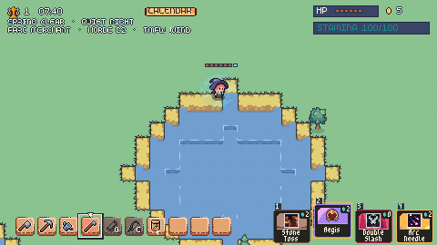
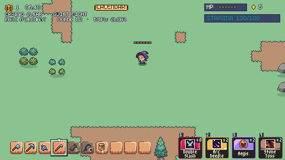
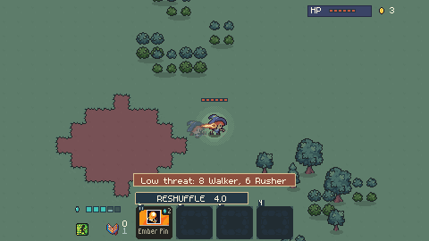
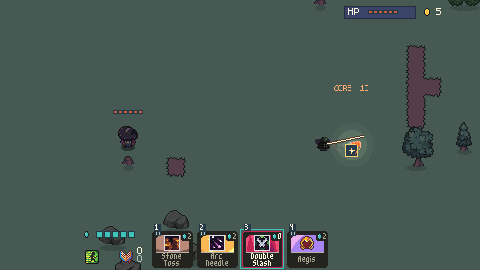

+++
title = "Drowned World: explore, edit, fight"
summary = "A playable playground connects seeded terrain, persistent edits, real card ownership, and a scheduled horde."
author = "Debter team · documentation excerpt"
date = 2026-10-11T13:09:03Z
commit = "d5a4eac9"
cover = "world_water.png"
+++

## The player experience

Move through connected terrain, change a patch of the world, and try an actual
deck against a horde. This **isolated prototype** lets the creator inspect those
systems together before choosing the next design direction. It remains on a
review branch, unmerged into the campaign.

## What the members connected

Seeded chunks use separate collision, navigation, and buildability masks.
World controls expand the map and edit terrain; Save/Continue restores those
edits in a separate prototype profile.

Catalogue grants create real owned cards and gems. Ember Pin casts through the
live deck. Scheduled enemies navigate the generated terrain and attack a debug
defense objective.

## Evidence and remaining questions

These are existing 480 × 270 native captures from the delivered playground,
bound to evidence commit `d5a4eac9`. The original feature article records
save/Continue, catalogue, world-control, and horde checks. This documentation
excerpt adds no new gameplay run.

Scripted checks and rendered captures establish specific behavior. Human
playtesting must still judge feel, readability, and balance. Controller usability
and a complete night run are not established by these images.

Gameplay art: **Hana Caraka by [Otterisk](https://otterisk.itch.io/)**.
This bundle contains rendered game captures, not reusable art assets.
